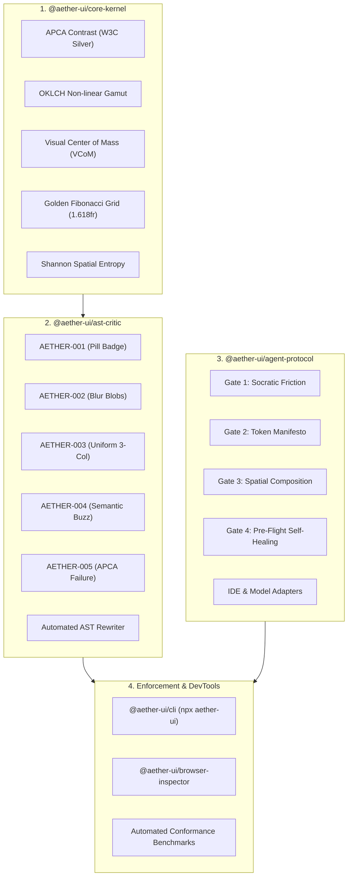

<div align="center">

# ▲ AETHER UI

**Perceptual Physics, Anti-Convergence AST Linter, and Universal Agent Directives**  
*Restoring scientific ergonomics, optical health, and post-cliché human craft to the synthetic software age.*

[](https://github.com/aether-ui/aether-ui/actions)
[](LICENSE)
[](docs/PERCEPTUAL_PHYSICS.md)
[](docs/PERCEPTUAL_PHYSICS.md)

</div>

---

## ⚡ The Manifesto: Eradicating AI Aesthetic Slop

Frontier large language models (GPT-4o, Claude 3.5 Sonnet, Gemini 2.0) are creating an unprecedented crisis of **aesthetic monoculture**. When prompted for web or product interfaces, autonomous models reliably regress to the statistical median of their training data, spewing identical tropes:

```
❌ The Generic AI Cliché Monolith:
┌────────────────────────────────────────────────────────┐
│         [ Introducing v2.0 -> ]  <-- Floating Pill     │
│                                                        │
│       Supercharge Your Workflow With Next-Gen AI       │
│                                                        │
│   ( * * * Radial Purple & Cyan Blur 3XL Blobs * * * )  │
│                                                        │
│  [  Feature 1  ]     [  Feature 2  ]     [ Feature 3 ] │
│  (Identical Card)    (Identical Card)   (Identical Card)│
│  Low contrast grey text that fails basic readability   │
└────────────────────────────────────────────────────────┘
```

This is not merely bad taste—it is **ocular and cognitive harm**:
- **Retinal Fatigue**: Chromostereopsis induced by high-chroma opposite-wavelength saturated purple and cyan blur blobs causes continuous ciliary muscle strain.
- **Cognitive Drift**: Dead-center vertical stacks ($\|\vec{T}_{\text{VCoM}}\| \approx 0$) fail to establish intentional focal hierarchy.
- **Accessibility Failures**: Subtle dark-grey-on-black text regularly flouts W3C APCA legibility minimums ($L_c < 60$).
- **Semantic Evaporation**: High-density domain ledgers and operational instrumentation are erased in favor of vacuous marketing copy.

**Aether UI replaces aesthetic slop with hermetic perceptual physics, deterministic AST linting, and universal agent directives.**

---

## 🏛 Architecture Overview



---

## 📦 Packages in this Monorepo

| Package | Role | Key Capabilities |
|:--------|:-----|:-----------------|
| [`@aether-ui/core-kernel`](packages/core-kernel) | **Pure Math & Physics Engine** | APCA contrast ($L_c$), OKLCH palette derivation, VCoM vector physics ($\vec{R}_{cm}$), golden grid ($\phi$), Shannon entropy. |
| [`@aether-ui/ast-critic`](packages/ast-critic) | **AST Linter & Auto-Fixer** | Multi-framework parser (JSX, Vue, Svelte, Tailwind) detecting clichés `AETHER-001` through `005` with AST recompilation. |
| [`@aether-ui/agent-protocol`](packages/agent-protocol) | **Universal Directives & Adapters** | 4-Gate operational protocol and pre-configured adapters for Cursor, Windsurf, Copilot, Antigravity, Aider, Claude Code, Gemini, Grok, v0. |
| [`@aether-ui/cli`](packages/cli) | **Terminal & CI Enforcement** | `npx aether-ui audit`, `fix`, `init`, and `compile-tokens`. |
| [`@aether-ui/browser-inspector`](packages/browser-inspector) | **DevTools Extension** | Chrome/Firefox extension projecting live VCoM heatmaps and APCA contrast overlays over the DOM. |
| [`benchmarks`](benchmarks) | **Research & Eval Suite** | Cosine similarity vectors & statistical distance benchmark measuring convergence across 1,000 AI sites vs human craft. |

---

## 🚀 Quickstart

### 1. Initialize Adapters in your Project
Instantly inject `.cursorrules`, `.windsurfrules`, and `antigravity.json` into your local workspace:

```bash
npx aether-ui init
```

### 2. Audit Workspace for AI Aesthetic Convergence
Scan your frontend templates (JSX, TSX, Vue, Svelte, HTML) for clichés and low-contrast text:

```bash
npx aether-ui audit
```

### 3. Automatically Patch Layouts
Automatically refactor uniform grids, eliminate blur blobs, upgrade low-contrast tokens, and replace corporate buzzwords with domain-accurate metrics:

```bash
npx aether-ui fix --file src/components/Hero.tsx
```

### 4. Compile Perceptual OKLCH CSS Variables
Generate mathematically harmonious CSS design tokens anchored to an OKLCH hue angle:

```bash
npx aether-ui compile-tokens --hue 220 --mode dark --out src/tokens.css
```

---

## 📐 Mathematical Foundations

### 1. Accessible Perceptual Contrast Algorithm (APCA)
Unlike legacy WCAG 2.1 relative luminance math, APCA models human cone photoreceptors using non-linear power-law transformations with polarity-specific exponents:
- **Positive Polarity (Dark on Light)**:
  $$S_{\text{bg}} = Y_{\text{bg}}^{0.56}, \quad S_{\text{txt}} = Y_{\text{txt}}^{0.62}$$
  $$L_c = (S_{\text{bg}} - S_{\text{txt}}) \cdot 1.14154 \cdot 100$$
- **Negative Polarity (Light on Dark)**:
  $$S_{\text{bg}} = Y_{\text{bg}}^{0.65}, \quad S_{\text{txt}} = Y_{\text{txt}}^{0.57}$$
  $$L_c = (S_{\text{bg}} - S_{\text{txt}}) \cdot 1.14154 \cdot 100$$

### 2. Visual Center of Mass (VCoM)
Aether computes the mechanical centroid of optical mass across the viewport:
$$\vec{R}_{\text{VCoM}} = \frac{\sum_{i=1}^N m_i \cdot \vec{r}_i}{\sum_{i=1}^N m_i}, \quad m_i = \text{Area}_i \cdot (\Delta L_i)^{1.25} \cdot (1 + 0.4 \kappa_i)$$
Dynamic asymmetrical layouts maintain $0.08 \le \|\vec{T}\| \le 0.35$ relative to geometric center $(W/2, H/2)$.

### 3. Golden Section Spatial Layout ($\phi \approx 1.618$)
Standard uniform grids (`grid-cols-3`) collapse hierarchy. Aether enforces golden section partitions:
$$\text{Major Section} = \frac{W}{\phi} \approx 61.8\% \cdot W, \quad \text{Minor Section} \approx 38.2\% \cdot W$$

---

## 🛡️ Governance & Alignment

- **Charter**: Formulated under the [Aether Open Governance Board](governance/CHARTER.md) (MIT CSAIL, Google AI Principles, W3C Silver contributors).
- **Ethics & Safety**: Strict adherence to the [Ethics & Ergonomic Safety Policy](governance/ETHICS_SAFETY_POLICY.md).
- **Google AI Principles**: Explicit mapping across Fairness, Safety, Accountability, and Scientific Excellence detailed in [AI_PRINCIPLES_ALIGNMENT.md](docs/AI_PRINCIPLES_ALIGNMENT.md).

---

## 📜 License

Licensed under the Apache License, Version 2.0. See [LICENSE](LICENSE) for details.
