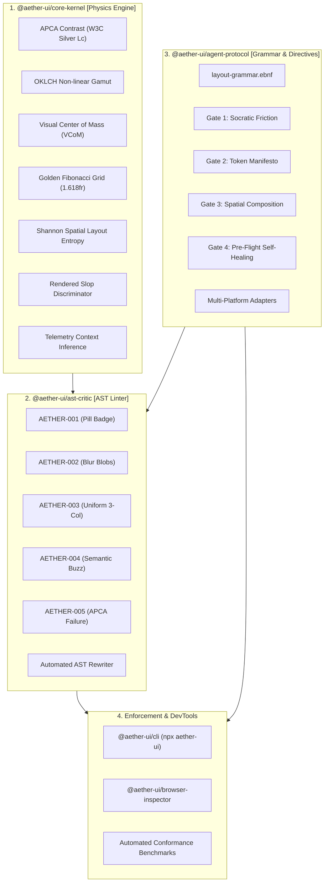

<div align="center">

# ▲ AETHER UI / AETHER KERNEL

**Perceptual Physics, Anti-Convergence AST Linter, and Universal Agent Directives**  
*Restoring scientific ergonomics, optical health, and post-cliché human craft to the synthetic software age.*

[](https://github.com/mohdshakir9897/aether-kernel/actions)
[](https://github.com/mohdshakir9897/aether-kernel/actions)
[](LICENSE)
[](docs/PERCEPTUAL_PHYSICS.md)
[](docs/PERCEPTUAL_PHYSICS.md)

</div>

---

## ⚡ The Manifesto: Eradicating AI Aesthetic Slop

Frontier large language models (GPT-4o, Claude 3.5 Sonnet, Gemini 2.0) are causing an acute crisis of **aesthetic monoculture**. When prompted for web or product interfaces, autonomous models reliably regress to the statistical median of their training weights, emitting the identical cliché template:

```
❌ The Generic AI Cliché Monolith (BANNED):
┌────────────────────────────────────────────────────────┐
│         [ Introducing v2.0 -> ]  <-- Floating Pill     │
│                                                        │
│       Supercharge Your Workflow With Next-Gen AI       │
│                                                        │
│   ( * * * Radial Purple & Cyan Blur 3XL Blobs * * * )  │
│                                                        │
│  [  Feature 1  ]     [  Feature 2  ]     [ Feature 3 ] │
│  (Identical Card)    (Identical Card)   (Identical Card)│
│  Low-contrast subtle grey text that flouts APCA minima │
└────────────────────────────────────────────────────────┘
```

This represents quantifiable **ocular and cognitive degradation**:
- **Retinal Fatigue & Accommodation Spasm**: Chromostereopsis induced by high-chroma opposite-wavelength saturated purple ($\approx 290^\circ$) and electric cyan ($\approx 180^\circ$) blur blobs forces continuous ocular focal oscillation.
- **Cognitive Drift**: Dead-center vertical stacks ($\|\vec{T}_{\text{VCoM}}\| \approx 0$) lack intentional focal direction.
- **Accessibility Failures**: Subtle dark-grey-on-black text regularly flouts W3C APCA legibility thresholds ($|L_c| < 60$).
- **Affordance Collapse**: High-density operational ledgers and technical streams are erased in favor of vacuous marketing copy.

**Aether Kernel replaces aesthetic slop with hermetic perceptual physics, deterministic AST linting, and universal agent directives.**

---

## 🏛 Architecture Overview



---

## 📦 Monorepo Packages

| Package | Role | Key Capabilities |
|:--------|:-----|:-----------------|
| [`@aether-ui/core-kernel`](packages/core-kernel) | **Pure Math & Physics Engine** | APCA contrast ($L_c$), OKLCH palette derivation, VCoM vector physics ($\vec{R}_{cm}$), golden grid ($\phi$), Shannon spatial entropy, rendered bounding box physics, telemetry context inference. |
| [`@aether-ui/ast-critic`](packages/ast-critic) | **AST Linter & Auto-Fixer** | Multi-framework parser (JSX, TSX, Vue, Svelte, Tailwind) detecting clichés `AETHER-001` through `005` with automated AST node recompilation. |
| [`@aether-ui/agent-protocol`](packages/agent-protocol) | **Universal Directives & Adapters** | Formal EBNF layout grammar, 4-Gate operational protocol, and adapters for Cursor, Windsurf, Copilot, Antigravity, Aider, Claude Code, Gemini, Grok, v0, and Bolt. |
| [`@aether-ui/cli`](packages/cli) | **Terminal & CI Enforcement** | `npx aether-ui audit [path]`, `fix [path]`, `init`, and `compile-tokens`. |
| [`@aether-ui/browser-inspector`](packages/browser-inspector) | **DevTools Extension** | Chrome/Firefox extension projecting live VCoM heatmaps and APCA contrast overlays directly over the browser viewport. |
| [`benchmarks`](benchmarks) | **Research & Eval Suite** | Cosine similarity vectors & statistical distance benchmark measuring convergence across 1,000 AI sites vs human craft. |

---

## 📐 Perceptual Physics & Formal Grammar

### 1. Formal Layout Grammar ([`layout-grammar.ebnf`](packages/agent-protocol/grammars/layout-grammar.ebnf))
Aether enforces an explicit Extended Backus-Naur Form (EBNF) grammar that structurally eliminates generic center stacks:

```ebnf
RootLayout ::= HeaderContainer PrimarySplitView FooterContainer
HeaderContainer ::= "<header " HeaderAttributes ">" (LeftAnchoredBrand NavList ContextualMetadata) "</header>"
PrimarySplitView ::= "<main class=\"grid " AsymmetricGridColumns " gap-6\">" PrimaryCanvas SecondaryPanel "</main>"

AsymmetricGridColumns ::= "grid-cols-1 lg:grid-cols-12" 
PrimaryCanvas ::= "<section class=\"lg:col-span-8\">" (InteractiveDataSurface | StructuralViewport) "</section>"
SecondaryPanel ::= "<aside class=\"lg:col-span-4\">" ContextualInspector "</aside>"
```

### 2. Rendered Spatial Physics & Mathematical Slop Discriminator
Given rendered element bounding boxes $\{B_i\}$, Aether evaluates layout distribution:
- **Spatial Shannon Entropy**:
  $$H(X) = -\sum_{i=1}^N p_i \log_2(p_i), \quad p_i = \frac{\text{Area}_i}{\sum \text{Area}}$$
- **Visual Center of Mass (VCoM) & Symmetry**:
  $$\bar{x}_{\text{VCoM}} = \frac{\sum x_i \cdot \text{Area}_i}{\sum \text{Area}_i}, \quad S = \max(0, 1 - 2|\bar{x} - 0.5|)$$
- **Slop Discriminator**:
  $$\text{isSlop} = \left(S > 0.94 \land H(X) < 1.8 \land N \ge 3\right)$$
- **Layout Energy Metric**:
  $$E = S + \frac{1}{H(X) + 0.01}$$

### 3. Accessible Perceptual Contrast Algorithm (APCA)
APCA models human cone photoreceptors using non-linear power-law transformations with polarity-specific exponents:
- **Positive Polarity (Dark on Light)**:
  $$S_{\text{bg}} = Y_{\text{bg}}^{0.56}, \quad S_{\text{txt}} = Y_{\text{txt}}^{0.62} \implies L_c = (S_{\text{bg}} - S_{\text{txt}}) \cdot 1.14154 \cdot 100$$
- **Negative Polarity (Light on Dark)**:
  $$S_{\text{bg}} = Y_{\text{bg}}^{0.65}, \quad S_{\text{txt}} = Y_{\text{txt}}^{0.57} \implies L_c = (S_{\text{bg}} - S_{\text{txt}}) \cdot 1.14154 \cdot 100$$

Mandatory contrast standards: $|L_c| \ge 60$ for standard body text, $|L_c| \ge 75$ for fine telemetry or code.

### 4. Telemetry Context Inference
The core kernel introspects workspace schemas without external dependencies:
- **Prisma**: Models (`model <Name> {`)
- **Drizzle**: Tables (`pgTable`, `sqliteTable`, `mysqlTable`)
- **OpenAPI / JSON Schema**: Entity definitions
- **Workspace Classifier**: Inferred domain (`high-precision-fintech`, `devtools-infra`, `editorial-luxury`, `general-b2b`) and density (`compact`, `balanced`, `editorial`).

---

## 🚀 Quickstart

### 1. Initialize Adapters in your Project
Inject `.cursorrules`, `.windsurfrules`, and `antigravity.json` into your local workspace:

```bash
npx aether-ui init
```

### 2. Audit Workspace for AI Aesthetic Convergence
Scan your frontend templates (JSX, TSX, Vue, Svelte, HTML) for clichés and low-contrast text:

```bash
# Scan full repository
npx aether-ui audit

# Scan specific directory in strict mode
npx aether-ui audit src/components/ --strict
```

### 3. Automatically Patch Layouts
Automatically refactor uniform grids, eliminate blur blobs, upgrade low-contrast tokens, and replace corporate buzzwords with domain-accurate metrics:

```bash
npx aether-ui fix --file src/components/Hero.tsx
```

### 4. Compile Perceptual OKLCH CSS Variables
Generate mathematically harmonious CSS design tokens anchored to an OKLCH hue angle:

```bash
npx aether-ui compile-tokens --hue 220 --mode dark --out src/tokens.css
```

---

## 🛠️ CI & Conformance Verification

In `.github/workflows/ci-core-kernel.yml`, Aether executes hermetic verification:
```yaml
- name: Verify Human Benchmark Clean Pass
  run: node packages/cli/dist/bin/aether.js audit benchmarks/datasets/1000-award-human-sites/ --strict

- name: Verify AI Slop Benchmark Is Successfully Flagged
  run: |
    if node packages/cli/dist/bin/aether.js audit benchmarks/datasets/1000-ai-generated-sites/ --strict; then
      echo "Error: AI Slop sample passed audit! Detector failed."
      exit 1
    else
      echo "Success: AI Slop sample correctly flagged and blocked by Aether Kernel."
    fi
```

---

## 🛡️ Governance & Ethical Alignment

- **Charter**: Formulated under the [Aether Open Governance Board](governance/CHARTER.md) (MIT CSAIL, Google AI Principles, W3C Silver contributors).
- **Ethics & Safety**: Strict adherence to the [Ethics & Ergonomic Safety Policy](governance/ETHICS_SAFETY_POLICY.md).
- **Google AI Principles**: Explicit mapping across Fairness, Safety, Accountability, and Scientific Excellence detailed in [AI_PRINCIPLES_ALIGNMENT.md](docs/AI_PRINCIPLES_ALIGNMENT.md).

---

## 📜 License

Licensed under the Apache License, Version 2.0. See [LICENSE](LICENSE) for details.
