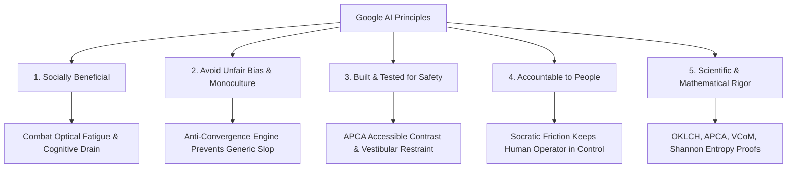

# Alignment with Google AI Principles & Ethical Guidelines

Aether UI is architected around foundational ethical imperatives for artificial intelligence in software development, with explicit mapping to Google AI Principles:

---

### Principle 1: Be socially beneficial
- **Problem**: Monocultural AI-generated code floods the web with repetitive, unoptimized user experiences that degrade human concentration, literacy, and accessibility.
- **Aether Alignment**: Aether restores cognitive ergonomics, visual clarity, and intentionality to software interfaces, ensuring that digital tools respect human attention spans and sensory limits.

### Principle 2: Avoid creating or reinforcing unfair bias
- **Problem**: Generative models trained on public web snapshots reinforce the aesthetic biases of superficial venture-backed SaaS landing pages (purple/cyan gradients, floating pills, vacuous marketing text), erasing domain-specialized, accessible, and regional software traditions.
- **Aether Alignment**: Aether enforces domain ontologies (industrial telemetry, clinical healthcare, high-frequency finance, public municipal services) that prioritize the diverse operational realities of end-users over aesthetic homogeneity.

### Principle 3: Be built and tested for safety
- **Problem**: Inaccessible color choices and low-contrast grey text cause ocular strain, headaches, and legibility failure for aging or visually impaired users. Sudden visual pulses and excessive radial motion can trigger vestibular discomfort.
- **Aether Alignment**: All color generation is validated using W3C APCA math ($L_c \ge 60$ minimum, $L_c \ge 75$ for fine text) and chromatic budget limits to guarantee visual safety and optical comfort.

### Principle 4: Be accountable to people
- **Problem**: Autonomous coding agents often assume intent without asking critical questions, outputting superficial placeholder designs.
- **Aether Alignment**: **Gate 1: Socratic Friction** obligates the agent to clarify operator intent, screen distance, ambient lighting, and data density before emitting UI components. Human agency remains primary.

### Principle 5: Incorporate principles of scientific excellence
- **Problem**: Web design has historically relied on ad-hoc heuristics, intuition, and broken color models (such as sRGB and WCAG 2.1).
- **Aether Alignment**: Core decisions are grounded in peer-reviewed perceptual physics (OKLCH color science, APCA luminance curves, Visual Center of Mass vector physics, and Shannon information entropy).
